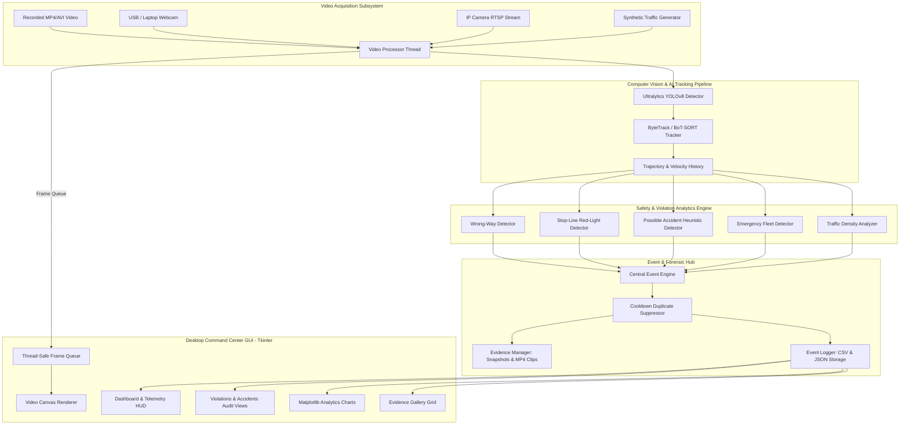

# Smart Road Vision (SafeRoad AI)
### AI-Based Intelligent Traffic Monitoring and Road Safety System
**B.Tech Major Project — Final Year Examination & Viva Demonstration**

---

## 1. Project Overview

**Smart Road Vision** is a modular, high-performance, real-time desktop surveillance and road safety management system designed for smart-city traffic control rooms. Built in Python using OpenCV, Ultralytics YOLOv8, ByteTrack, NumPy, Pandas, Matplotlib, and Tkinter, it provides continuous traffic surveillance, automated violation detection, heuristic collision triage, priority emergency vehicle routing, and structured forensic evidence archiving.

### Key Capabilities
- **Multi-Source Video Ingestion**: Recorded video files (`.mp4`, `.avi`), live laptop/USB webcams, and IP camera RTSP streams.
- **Deep Learning Object Detection**: Ultralytics YOLOv8 for detecting vehicles (`car`, `motorcycle`, `bus`, `truck`) and pedestrians with configurable confidence and IoU thresholds.
- **Multi-Object Tracking**: Persistent tracking across consecutive frames via ByteTrack and BoT-SORT with motion trajectory history and unique counting.
- **Wrong-Way Driving Detection**: Temporal directional consistency analysis over historical displacement vectors against configurable road directions.
- **Stop-Line Red-Light Violation Detection**: Geometric line-intersection checks across a configurable virtual stop line synchronized with traffic signal states.
- **Possible Accident Detection**: Multi-indicator heuristic analysis evaluating sudden deceleration, collision proximity, and sustained roadway stoppage.
- **Priority Emergency Fleet Alerting**: Modular interface for ambulances, fire engines, and police vehicles with priority routing and audio/visual alerts.
- **Real-Time Traffic Density Analysis**: Real-time traffic condition categorization (`LOW`, `MEDIUM`, `HIGH`) and time-series historical density recording.
- **Central Event Engine**: Thread-safe duplicate suppression cooldowns, standardized schemas, and automated snapshot/clip evidence generation.
- **Forensic Repository & Verification Workflow**: Dual-persisted CSV and JSON audit logging, full-resolution JPEG evidence snapshots, MP4 video clips, and human-in-the-loop confirmation (`CONFIRMED`, `FALSE POSITIVE`, `REVIEWED`).
- **Dark Control-Room Dashboard**: High-tech Tkinter GUI with 9 dedicated workspaces, responsive live canvas, and embedded Matplotlib analytics.

---

## 2. System Architecture



---

## 3. Project Directory Structure

```
Smart Road Vision/
├── main.py                     # Primary executable entry point & CLI controller
├── requirements.txt            # Python package dependencies
├── README.md                   # Complete architectural documentation & viva guide
├── sample_traffic.mp4          # Real-life 720p city intersection CCTV traffic video (~1 min)
├── real_traffic_highway.mp4    # Real-life multi-lane highway surveillance video (cars, trucks, buses)
├── sample_synthetic_traffic.mp4# Synthetic simulation test video for offline viva testing
├── config/
│   ├── default_config.json     # Factory default system parameters
│   └── user_config.json        # User customized saved parameters
├── models/
│   ├── yolov8n.pt              # YOLOv8 nano vehicle & tracking weights (~6.5MB)
│   └── accident_yolo11x.pt     # Fine-tuned YOLO11x Traffic Accident Detection weights (~114MB)
├── utils/
│   ├── download_accident_model.py # Automated HuggingFace weights downloader
│   └── generate_traffic_video.py  # Synthetic test video generator
├── src/
│   ├── __init__.py
│   ├── config_manager.py       # Configuration loading, validation, and persistence
│   ├── detector.py             # Ultralytics YOLOv8 inference wrapper
│   ├── tracker.py              # Multi-object tracking, trajectory deque, velocity & counting
│   ├── violation_detector.py   # Wrong-way trajectory and stop-line crossing logic
│   ├── accident_detector.py    # Dual-Engine: Fine-tuned YOLO11x AI Vision + Kinematics Heuristics
│   ├── emergency_detector.py   # Priority emergency vehicle detection interface
│   ├── traffic_analyzer.py     # Density estimation (LOW/MED/HIGH) & time-series logging
│   ├── evidence_manager.py     # Annotated JPEG snapshot & MP4 clip generator
│   ├── event_logger.py         # Thread-safe CSV/JSON persistence & verification updater
│   ├── video_processor.py      # Background worker thread & frame HUD overlay renderer
│   ├── event_engine.py         # Central coordinator, duplicate suppression, dispatching
│   └── gui/
│       ├── __init__.py
│       ├── theme.py            # High-tech dark control-room theme, palettes & TTK styles
│       ├── app.py              # Root Tkinter application and controller
│       ├── dashboard_view.py   # Command center KPIs, mini stream, recent alerts ticker
│       ├── monitoring_view.py  # Full-screen video player, controls, overlays, signal lamp
│       ├── violations_view.py  # Traffic violation audit, snapshot inspector, verification
│       ├── accidents_view.py   # Collision incident triage, impact assessment, clip player
│       ├── emergency_view.py   # Priority corridor clearance & custom model manager
│       ├── analytics_view.py   # Embedded Matplotlib charts (Violations, Vehicles, Density)
│       ├── logs_view.py        # Comprehensive audit log table, filters, CSV exporter
│       ├── gallery_view.py     # Forensic evidence thumbnail grid & modal preview dialog
│       ├── settings_view.py    # AI parameters, thresholds, stop line coordinates, cooldown
│       └── components/
│           ├── stat_card.py    # Metric card widget
│           ├── video_canvas.py # Aspect-ratio preserving video canvas with standby radar
│           └── alerts_ticker.py# Real-time incident feed widget
├── utils/
│   └── generate_traffic_video.py # Synthetic video generator script with multi-lane traffic
├── data/
│   ├── logs/
│   │   ├── events.csv          # Persistent CSV log
│   │   └── events.json         # Persistent JSON log
│   ├── evidence/
│   │   ├── wrong_way/          # Snapshots for wrong-way driving
│   │   ├── red_light/          # Snapshots for red-light crossing
│   │   ├── no_helmet/          # Snapshots for two-wheeler helmet audits
│   │   ├── possible_accident/  # Snapshots and MP4 clips for possible accidents
│   │   ├── emergency_vehicle/  # Snapshots for emergency units
│   │   └── road_safety/        # General road safety notifications
│   └── exports/                # Output directory for exported filtered CSV reports
└── tests/
    ├── __init__.py
    ├── test_event_engine.py    # Unit tests for duplicate suppression & event schema
    ├── test_rules.py           # Unit tests for wrong-way, red-light, and density rules
    └── test_logger.py          # Unit tests for CSV/JSON logging & verification status updates
```

---

## 4. Installation and Setup (Windows 10 / 11)

### Prerequisites
1. **Python 3.11 or higher** (Python 3.11, 3.12, 3.13, 3.14 supported).
2. **Pip** package manager.
3. A Windows PC with standard webcam or video playback capabilities.

> [!NOTE]
> On Windows, Python is frequently invoked via the standard Python launcher `py` rather than `python` (which Windows often redirects to the Microsoft Store). You can also double-click `run.bat` or `run_demo.bat` to launch with one click.

### Step-by-Step Setup
Open PowerShell or Command Prompt in the project folder:

```powershell
# 1. Verify Python installation via 'py' or 'python'
py --version

# 2. Install project dependencies
py -m pip install -r requirements.txt
```

### Running Automated Test Suite
To verify the entire detection pipeline, event engine, and file loggers:
```powershell
py main.py --test
# or
python main.py --test
```
*All 14 unit and integration test suites pass cleanly.*

---

## 5. Running the Application

### Option A: One-Click Batch Launchers (Easiest for Windows)
- Double-click **`run_demo.bat`** in File Explorer to launch with demo traffic video auto-started.
- Double-click **`run.bat`** to launch the standard command center.

### Option B: Command Prompt / PowerShell Launch
```powershell
# Standard launch
py main.py

# Quick Demonstration Mode (Auto-starts Demo Video)
py main.py --demo

# Launch with Custom Video File
py main.py --video "C:\path\to\traffic_clip.mp4"

# Launch with Webcam Feed
py main.py --webcam 0

# Regenerate Demonstration Video
py main.py --generate
```

*(Note: If `python` is in your system PATH, you can also use `python main.py` instead of `py main.py`)*


---

## 6. Detailed Module Breakdown

### 1. `src/detector.py` (ObjectDetector)
- Encapsulates Ultralytics YOLOv8 inference.
- Targets COCO traffic classes: Class 0 (`person`), Class 2 (`car`), Class 3 (`motorcycle`), Class 5 (`bus`), Class 7 (`truck`).
- Configurable confidence threshold (`conf`) and Intersection-over-Union (`iou`) suppression.
- Interfaces for optional custom-trained weights (`custom_helmet_model`, `custom_emergency_model`).
- Transparent failure handling: If weights are absent, provides descriptive warnings rather than dummy mockups.

### 2. `src/tracker.py` (TrafficTracker & TrackedObject)
- Manages multi-object tracking using ByteTrack / BoT-SORT algorithms.
- Each `TrackedObject` maintains a rolling `deque` of recent coordinate centers, velocity vectors `(dx, dy)`, smoothed speed (px/frame), and cardinal heading (`TOP_TO_BOTTOM`, `BOTTOM_TO_TOP`, `LEFT_TO_RIGHT`, `RIGHT_TO_LEFT`).
- Tracks unique vehicle counts across vehicle classes, eliminating multi-counting on consecutive frames.
- Automatically prunes stale tracks missing for over 30 frames.

### 3. `src/violation_detector.py` (ViolationDetector)
- **Wrong-Way Driving**: Computes net spatial displacement over an observation window (default 10 frames). Compares movement against configured corridor direction (e.g., `TOP_TO_BOTTOM`). Flags vehicles moving contrary to permitted flow once minimal displacement threshold is achieved.
- **Red-Light Violation**: Uses computational geometry line segment intersection (`lines_intersect`) between a tracked vehicle's trajectory `(x_t-1, y_t-1)` -> `(x_t, y_t)` and the virtual stop line segment `(x1, y1)` -> `(x2, y2)`. Violation is generated strictly when the traffic signal state is `RED`.
- Safeguards prevent duplicate alerts for the same tracking ID.

### 4. `src/accident_detector.py` (PossibleAccidentDetector)
- Evaluates multi-indicator kinematic patterns:
  1. **Sudden Deceleration**: Detects rapid drop from active velocity (>5 px/f) to near zero within a short temporal window.
  2. **Abnormal Roadway Standstill**: Detects sustained stationary state (>18 frames) within active driving lanes.
  3. **Multi-Vehicle Proximity Interaction**: Detects close inter-vehicle distance (<55 px) followed by immediate standstill of either vehicle.
- Emphasizes academic transparency: Clearly documented as a heuristic triage indicator.

### 5. `src/emergency_detector.py` (EmergencyVehicleDetector)
- Routes priority emergency fleet events (Ambulance, Fire Brigade, Police).
- Hooks into custom fine-tuned YOLO weights.
- When detected: flags critical severity, archives forensic snapshot, and updates the Priority Emergency Fleet workspace.

### 6. `src/traffic_analyzer.py` (TrafficDensityAnalyzer)
- Calculates real-time road occupancy based on visible tracked vehicles.
- Classifies traffic condition into 3 tiers based on configurable boundaries:
  - **LOW**: $\le 3$ vehicles (Emerald Green)
  - **MEDIUM**: $4$ to $7$ vehicles (Amber Warning)
  - **HIGH**: $> 7$ vehicles (Coral Red)
- Records time-series observations used by Matplotlib analytics.

### 7. `src/event_engine.py` (EventEngine)
- Central nexus connecting detectors to file persistence and UI alerts.
- Enforces duplicate suppression cooldown (default 8.0 seconds) per `(event_type, tracking_id)`.
- Standardizes schema: `event_id`, `timestamp`, `event_type`, `severity`, `camera_or_source`, `tracking_id`, `confidence`, `description`, `evidence_path`, `verification_status`.
- Automatically calls `EvidenceManager` to save annotated snapshots and rolling MP4 clips.

### 8. `src/event_logger.py` (EventLogger)
- Thread-safe persistence to both `data/logs/events.csv` and `data/logs/events.json`.
- Supports atomic status updates (`PENDING REVIEW` -> `CONFIRMED` / `FALSE POSITIVE` / `REVIEWED`).
- Provides filtered Pandas queries and custom CSV export.

### 9. `src/evidence_manager.py` (EvidenceManager)
- Saves timestamped JPEG snapshots with bounding box overlays, target banner, and forensic metadata header.
- Captures rolling buffer MP4 video clips via OpenCV `VideoWriter`.
- Organizes media into structured folders: `wrong_way/`, `red_light/`, `possible_accident/`, `emergency_vehicle/`, `road_safety/`.

### 10. `src/video_processor.py` (VideoProcessor)
- Runs video reading, inference, and rendering inside a background daemon thread.
- Feeds processed frames to Tkinter via a thread-safe `queue.Queue(maxsize=4)` with frame dropping to prevent UI lag.
- Renders HUD overlays: bounding boxes, trajectory polylines, virtual stop line, lane direction arrow, traffic signal lamp, and telemetry banner.

### 11. `src/gui/app.py` & Views
- Dark control room theme (`#0b0f19`, `#161e2e`, `#38bdf8`).
- 9 fully functional sidebar views:
  1. **Dashboard**: High-level KPIs, mini stream, severity bar chart, real-time alert ticker.
  2. **Live Monitoring**: Large video canvas, source picker, playback controls, overlay toggles, live traffic signal controller (RED/YELLOW/GREEN), telemetry sidebar.
  3. **Traffic Violations**: Tab-filtered violation table, snapshot preview, confirm/false-positive verification buttons.
  4. **Accident Alerts**: Possible accident incident list, heuristic indicator breakdown, snapshot/clip launcher, academic disclaimer banner.
  5. **Emergency Vehicles**: Priority emergency feed, custom model status, corridor details.
  6. **Traffic Analytics**: 4 embedded Matplotlib charts (Violations Breakdown, Vehicle Distribution Donut, Density Timeline, Audit Status).
  7. **Event Logs**: Searchable, filterable audit log grid with CSV export.
  8. **Evidence Gallery**: Visual thumbnail grid of saved evidence with full-resolution inspection modal.
  9. **Settings**: Configuration editor for model paths, confidence thresholds, tracker choices, virtual stop line coordinates, signal simulation, and cooldowns.

---

## 7. How to Test & Demonstrate During College Viva

### 1. Synthetic Video Demonstration
The project includes a realistic synthetic video generator `utils/generate_traffic_video.py` that generates `sample_traffic.mp4`.
1. Run `python main.py --demo`.
2. The application opens and immediately plays the video with YOLOv8 detection and ByteTrack tracking.
3. Observe:
   - Green/Cyan bounding boxes with tracking IDs and estimated speed.
   - Vehicle counting by category in the HUD.
   - A vehicle moving upward in the southbound lane triggers a **WRONG_WAY** violation.
   - When the traffic signal button is set to **RED**, a vehicle crossing the stop line triggers a **RED_LIGHT** violation.
   - The event is immediately logged to CSV and JSON.
   - An annotated snapshot is saved to `data/evidence/`.
   - The event appears in the Dashboard ticker and the Event Logs table.

### 2. Live Webcam Testing
1. Launch `python main.py`.
2. In the **Live Monitoring** tab, select **SOURCE: webcam**.
3. Enter index `0` (or `1` for external USB webcam).
4. Click **Start Monitoring**.
5. Move miniature toy cars, bicycles, or a hand in front of the camera to verify real-time tracking and bounding box display.

### 3. Human-in-the-Loop Verification Demonstration
1. Navigate to **Traffic Violations** or **Event Logs**.
2. Select any logged violation event from the table.
3. Review the snapshot in the right-hand inspection card.
4. Click **✔ Confirm** or **✖ False Alarm**.
5. Observe the status change to `CONFIRMED` or `FALSE POSITIVE` immediately in the UI and persistent CSV/JSON files.
6. Navigate to **Traffic Analytics** and observe the audit status chart update.

---

## 8. Viva Presentation Q&A Preparation

| Question | Examiner's Focus | Ideal Technical Answer |
| :--- | :--- | :--- |
| **Why use ByteTrack over simple Euclidean tracking?** | Multi-object tracking robustness | ByteTrack associates both high-confidence and low-confidence detection boxes using Kalman filtering and bipartite matching (via the Hungarian/LAP algorithm). This prevents lost tracks when vehicles temporarily occlude each other. |
| **How is wrong-way driving determined?** | Trajectory analysis vs single-frame noise | We inspect the historical displacement vector $(\Delta x, \Delta y)$ over a temporal window of consecutive frames (default 10 frames). A single frame of jitter is ignored; the vehicle must sustain displacement opposing the configured corridor direction with high consistency. |
| **Does YOLO detect red traffic lights automatically?** | Computer vision vs system state logic | Pretrained COCO YOLO detects road users (cars, buses, bikes, pedestrians). In intelligent traffic systems, traffic signal phase data comes from signal controllers or designated virtual states. Our system models this via configurable stop-line intersection logic synchronized with the signal state. |
| **How does Possible Accident Detection work?** | Heuristic triage vs end-to-end classification | Rather than claiming guaranteed accident classification without domain-specific datasets, we implement a transparent multi-indicator heuristic engine that checks for sudden velocity drops (>75%), sustained stoppage (>18 frames) in active lanes, and close inter-vehicle proximity (<55 px). |
| **Why Tkinter over web frameworks for this project?** | Architectural choice | Tkinter provides an ultra-lightweight, zero-dependency desktop application that runs natively on Windows laptops with low CPU and RAM overhead, eliminating web server, browser latency, and socket overhead during video streaming. |
| **How is thread safety maintained in Tkinter?** | Concurrency in GUI apps | Tkinter's event loop is single-threaded. OpenCV video capture and YOLO inference execute inside a dedicated background worker thread. Frames and events are passed via a thread-safe `queue.Queue`. The GUI polls the queue using `root.after()`, guaranteeing that Tkinter widgets are updated strictly from the main thread. |

---

## 9. Troubleshooting Common Issues

1. **`ModuleNotFoundError: No module named 'cv2'` or `'ultralytics'`**:
   Ensure dependencies are installed in your active environment:
   ```powershell
   pip install -r requirements.txt
   ```
2. **Webcam fails to open (`cap.isOpened() == False`)**:
   - Ensure another application (Teams, Zoom, Camera app) is not using the camera.
   - In Settings or the Monitoring tab, switch the camera index from `0` to `1`.
3. **Video ends or freezes**:
   Recorded videos automatically loop for continuous demonstration. If playback is paused, click **⏵ Resume**.
4. **YOLO model download issue**:
   The nano model weights `models/yolov8n.pt` are pre-packaged. If missing, Ultralytics downloads it automatically, or place any compatible YOLOv8 `.pt` file in `models/` and select it in Settings.

---

## 10. License and Authorship
Developed as a B.Tech Final Year Major Project in Computer Science and Engineering.
*All rights reserved.*
